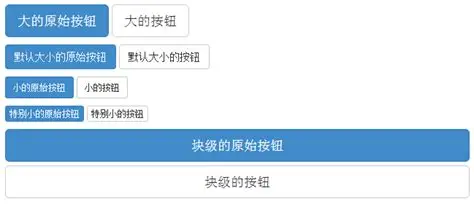

我已经不知道我看了多少这样的网页了。反正点进去就能看到暗黑背景、Inter 字体、蓝色紫色渐变的光晕按钮，然后是三列等宽卡片网格。哦对了还有圆角矩阵。

感觉现在已经有了全新的公式化拼好页了。

我觉得上面设计最大的亮点就是奶龙。已经品鉴了足够多了，就好像十年前这种样子的按钮在网上到处走。

ohno 请端下去吧。

我自己也用了不少 AI 来搓前端。所以或许最重要的是，如何在用 AI 辅助实现想要的开发效果时，坚持让它实现自己心目中的视觉效果。